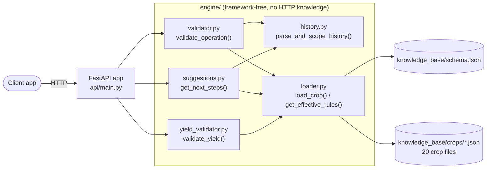
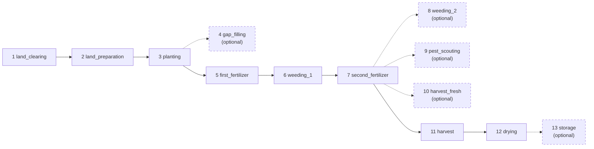
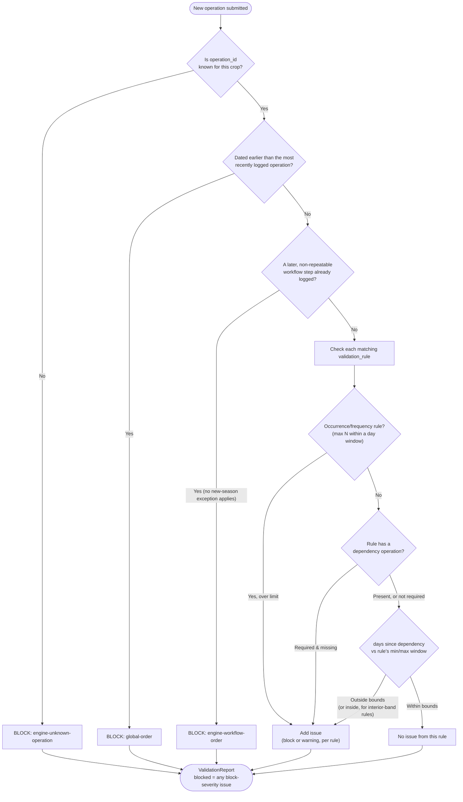
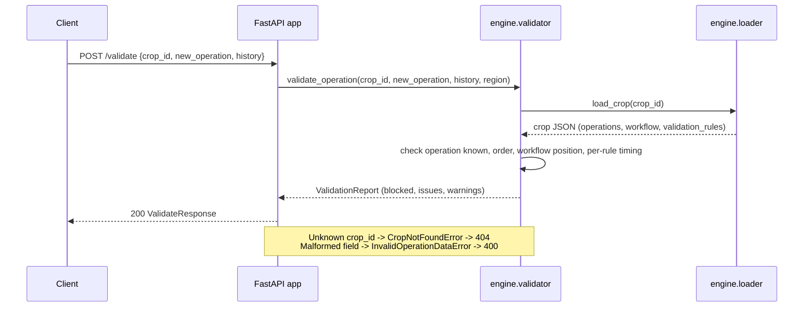
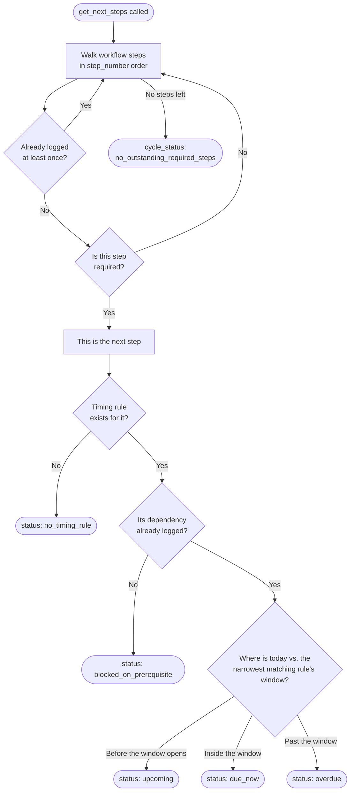

# AgTrail Knowledge Base

Crop knowledge base, schema, and validation tooling for AgTrail's Workflow & Validation Engine.

This project is the data layer discussed with the tech team: every crop is a structured JSON file (not free text, not hardcoded app logic) that the backend loads at runtime to know what operations exist, what order they go in, and what timing/sequence rules to enforce.

**The API is live and deployed:** `https://validation.agrolinking.com`

Try it directly, no setup required, at `https://validation.agrolinking.com/docs`. The service runs on a VPS (containerized via the repo's `Dockerfile`), behind Cloudflare, no cold starts to worry about. `.github/workflows/keep-alive.yml` is kept as a manual-trigger health-check backup.

## Architecture



`engine/` has no dependency on FastAPI or HTTP at all — `api/` is a thin translation layer on top of it, which is why `engine.validator.validate_operation` can also be called directly in Python or from the CLI (`engine/cli.py`) with no server running.

**What a crop file's `workflow` actually encodes** (maize's, as a concrete example — this is the `step_number` order `validate_operation` enforces):



Solid arrows are required steps in order; dashed are optional (skippable without blocking later steps). Every crop file defines its own `workflow` the same way — perennials like cocoa never reach a terminal step the way an annual crop does, which is why the "new season" exception in the validation flow below only applies to crops where harvest is a genuine cycle boundary.

## Project layout

```
agtrail-knowledge-base/
├── knowledge_base/
│   ├── schema.json          # the contract every crop file must follow
│   └── crops/               # 20 crops: all 5 High-priority + all Medium-priority tiers, plus
│                             # the earlier maize/cocoa/cassava/tomato/rice templates
├── engine/
│   ├── loader.py            # loads a crop file, applies regional_overrides patches
│   ├── history.py           # shared FarmOperation parsing + crop-scoping (used by validator and suggestions)
│   ├── validator.py         # validate_operation(): the core validation function
│   ├── suggestions.py       # get_next_steps(): what's due next, and whether it's overdue
│   ├── yield_validator.py   # validate_yield(): is the reported harvest amount plausible
│   ├── exceptions.py        # CropNotFoundError, InvalidOperationDataError
│   └── cli.py                # thin CLI wrapper: `agtrail-engine validate <scenario.json>`
├── api/
│   ├── main.py                # FastAPI app: POST /validate, POST /suggestions, POST /validate-yield, GET /crops, GET /health
│   └── schemas.py             # request/response models
├── scenarios/
│   └── *.json                # example farm records to try against the engine
├── scripts/
│   └── validate_crops.py    # CLI: validates all crop files against schema.json
├── tests/
│   ├── test_schema_validation.py   # schema + cross-reference checks
│   ├── test_engine.py              # validation engine behavior, including the stress-test cases
│   ├── test_suggestions.py         # suggestions engine behavior
│   ├── test_yield_validator.py     # yield validation behavior
│   └── test_api.py                  # API behavior, using FastAPI's TestClient
├── docs/
│   ├── knowledge_base_notes.md     # design notes: how each field maps to the
│   │                                # workflow/validation discussion, and next steps
│   └── agronomist_review_package.md # plain-language doc for a domain reviewer
├── .github/workflows/
│   └── keep-alive.yml       # manual-trigger health-check backup
├── Dockerfile
├── .dockerignore
├── pyproject.toml
└── .gitignore
```

## Setup

```bash
# from the project root
python3 -m venv .venv
source .venv/bin/activate        # Windows: .venv\Scripts\activate

pip install -e ".[dev,api]"
```

## Usage

**Validate all crop files** (schema shape + cross-references, e.g. catching a `validation_rule` that points at an `operation_id` that doesn't exist):

```bash
python scripts/validate_crops.py
```

**Run the same checks as tests:**

```bash
pytest
```

Both should currently pass for `maize.json`, `cocoa.json`, and `cassava.json`.

**Try the validation engine against a scenario:**

```bash
agtrail-engine validate scenarios/maize_valid_planting.json
agtrail-engine list-crops
```

Or call it directly in Python:

```python
from engine.validator import validate_operation

report = validate_operation(
    crop_id="maize",
    region="Nigeria - Guinea Savanna",
    history=[{"operation_id": "planting", "date": "2026-04-15"}],
    new_operation={"operation_id": "first_fertilizer", "date": "2026-04-22"},
)

print(report.blocked, report.warnings)
```

See `scenarios/` for worked examples, including the two structural stress tests: a regional override changing the outcome for identical dates (`maize_regional_guinea_savanna.json` vs `maize_regional_sudan_savanna.json`), and cassava's harvest rule correctly warning but not blocking on a very late harvest (`cassava_extended_in_ground_harvest.json`).

**A farm growing more than one crop:** if you're validating against combined history from a farm that grows, say, both maize and cassava, tag each history entry (and the new operation) with `"crop_id"` so the engine can tell them apart:

```python
history = [
    {"operation_id": "planting", "date": "2026-01-10", "crop_id": "maize"},
    {"operation_id": "planting", "date": "2026-03-15", "crop_id": "cassava"},
]
```

Without tags, the engine can't distinguish which entry belongs to which crop and may pick up the wrong dependency date. This was a real bug caught during testing (documented in `tests/test_engine.py`, `test_mixed_crop_history_without_tags_is_genuinely_ambiguous`) — tagging is the fix, and it's opt-in rather than required, so single-crop callers don't need to change anything.

**How `validate_operation` decides, in order:**



The real logic (`engine/validator.py`) handles more nuance than this diagram shows — the "new season" exception for annual crops, interior-band warning windows, self-referential interval rules — all documented inline in the source and locked in by `tests/test_engine.py`.

**Error handling:** `validate_operation` raises `engine.exceptions.CropNotFoundError` for an unrecognized `crop_id`, and `engine.exceptions.InvalidOperationDataError` for a missing or malformed field (like a bad date format), rather than letting a raw `KeyError` or `ValueError` leak out. An unrecognized `operation_id` (a typo, or an operation that belongs to a different crop) is treated as a normal validation failure, not an exception, it comes back as a blocked `ValidationReport` with a clear message.

## Running the API

**Live, deployed version:** `https://validation.agrolinking.com` — try `/docs` directly in a browser, nothing to install. Deployed via Docker (`Dockerfile` in the project root) on a VPS.

**Running it locally instead:**

```bash
uvicorn api.main:app --reload
```

Then, with the server running:

```bash
curl http://127.0.0.1:8000/crops
curl -X POST http://127.0.0.1:8000/validate \
  -H "Content-Type: application/json" \
  -d @scenarios/maize_valid_planting.json
```

Interactive docs (generated automatically) are at `http://127.0.0.1:8000/docs`.

Endpoints:

| Method | Path | What it does |
|---|---|---|
| `GET` | `/health` | Basic liveness check |
| `GET` | `/crops` | Lists available crop ids |
| `POST` | `/validate` | Same input shape as a scenario file, returns a validation report |
| `POST` | `/suggestions` | What's due next for a farm, and whether it's overdue |
| `POST` | `/validate-yield` | Checks a reported harvest yield (t/ha) against the crop's tiered ranges, independent of timing |

Error responses: a `404` for a `crop_id` that doesn't exist, a `400` for a malformed field (like a bad date), and a `422` for a request missing a required field entirely (handled by FastAPI's own request validation, before our code even runs). All three are tested in `tests/test_api.py`.

A `POST /validate` request, end to end:



## Suggestions: what's due next

Separate from validation. Instead of checking whether a submitted record is valid, this answers "what should this farm do next, and by when."

```python
from engine.suggestions import get_next_steps

report = get_next_steps(
    crop_id="maize",
    history=[
        {"operation_id": "land_clearing", "date": "2026-04-01"},
        {"operation_id": "land_preparation", "date": "2026-04-10"},
    ],
)

print(report.suggestion.operation_id)   # "planting"
print(report.suggestion.status)          # "due_now", "upcoming", or "overdue"
```

Or over the API:

```bash
curl -X POST http://127.0.0.1:8000/suggestions \
  -H "Content-Type: application/json" \
  -d '{"crop_id": "maize", "history": [{"operation_id": "land_clearing", "date": "2026-04-01"}, {"operation_id": "land_preparation", "date": "2026-04-10"}]}'
```

This is a `POST`, even though it's conceptually a read, because it needs to send a `history` array, which doesn't fit into a `GET` request. Documented directly in `api/main.py`.

**How `get_next_steps` decides:**



**This is a deliberately narrow v1.** It only looks at the next required, not-yet-logged step in the crop's workflow, and estimates a due window from the matching `validation_rule`. It does **not** model recurring due dates, once an operation has been logged even once, this stops suggesting it, even for operations that realistically need to happen again (a second round of weeding, cocoa's next seasonal harvest). That gap is intentional and documented in `engine/suggestions.py`'s module docstring rather than guessed at, modeling recurrence properly (weeding_2 isn't just "weeding_1 again," cocoa's harvest recurs with no interval currently encoded anywhere in the schema) is a real design problem for a later pass, not something to improvise here.

One more thing worth knowing: "overdue" in a suggestion is relative to whichever rule the engine picks as the *typical* window, which is not always the same as the validator's hard block boundary. Cassava is the clearest example, its suggestion can say "overdue" once a farm passes the 270 to 450 day typical harvest window, even though the validator itself would never reject a late cassava harvest, since cassava's actual block rule has no upper bound at all. A reminder nudging someone past the normal window is still useful even when the crop is more forgiving than that window suggests. This is tested explicitly in `tests/test_suggestions.py`.

## A real bug: operations logged out of workflow order

The tech team reported that Land Preparation, Planting, and Harvest could all be logged on the same date without any flags being raised. This was real, and the root cause was worse than it first sounded: every existing rule only checked an operation's relationship to its *own* declared dependency (e.g. "does planting come after land preparation"), never its position relative to *everything else* already logged. So `land_preparation` submitted *after* `planting` and `harvest` already existed in history passed cleanly, since nothing was checking "has a later workflow step already happened?"

`validate_operation` now includes a workflow-order sanity check: logging a one-time (non-repeatable) operation is blocked if a *later* one-time operation, per the crop's workflow order, has already been logged. This is deliberately more careful than it sounds, because a naive version of this fix would incorrectly block a real, legitimate case: starting a new planting season. Logging `land_clearing` again after a prior harvest is exactly how a farmer begins season two on an annual crop, that must still work.

The fix distinguishes crops where harvest is a genuine cycle boundary (annual, single-harvest crops like maize, cassava, rice) from crops where it isn't (cocoa and cashew's recurring seasonal harvest, tomato and hibiscus's multiple picks within one planting). Only the former get a "new cycle" exception, and even then, only when the newly submitted operation is dated *strictly after* the last harvest, not on the same date as it, since a same-date submission is indistinguishable from the original bug rather than a believable restart. This edge case was caught while building the fix and is tested explicitly (`test_workflow_order_check_new_season_restart_same_date_as_harvest_is_not_trusted`).

Nine tests in `tests/test_engine.py` cover this: the exact reported scenario, the same bug generalized beyond same-date submissions, and every legitimate case that must keep working (new season restart, repeatable operations interleaving freely, perennial crops never getting a cycle reset, and a full valid sequence validated step by step).

## Yield validation: is the reported harvest amount plausible

A separate dimension from everything above. `validate_operation` checks *when* something happened; `validate_yield` checks *how much* was reported at harvest (tonnes per hectare), completely independent of timing. A record can be perfectly timed and still report an impossible yield, a unit typo (kg entered where tonnes was expected), an inflated area, or a genuine total crop failure that should be logged as a loss event rather than a harvest.

```python
from engine.yield_validator import validate_yield

result = validate_yield("maize", 12.0)
print(result.severity)   # "block" -- exceeds the biological ceiling for rainfed maize
```

Or over the API:

```bash
curl -X POST http://127.0.0.1:8000/validate-yield \
  -H "Content-Type: application/json" \
  -d '{"crop_id": "maize", "tonnes_per_hectare": 12.0}'
```

This was introduced by the **AgTrail Master Agronomist & Validator Ruleset** (Agrolinking Solutions Ltd., July 2026), the first genuine agronomist-authored review this project has received, everything before it was self-sourced from public agricultural guides. Every crop has a 5-tier structure: exactly 0 must be logged as a Loss/Disaster Event rather than a harvest, very low but nonzero is a warning, a normal range passes, unusually high is a warning, and implausibly high is a hard block. **Maize, Tomato, Sesame, Ginger, Cashew, and Hibiscus** have this populated so far (Cashew's is reported per year, `t/ha/yr`, since it's a recurring perennial harvest, not a one-time total); calling `validate_yield` on a crop without this data raises a clear error rather than guessing.

**Known limitation, stated plainly:** the source ruleset ties this to GPS-polygon-anchored area, not self-reported area. AgTrail does not implement GPS-based area verification yet, so a self-reported area could still be used to game the resulting t/ha figure even with this check in place. This catches the clearest cases, not everything.

One implementation detail worth knowing if you're extending this: some tiers can legitimately overlap. A yield of 12 t/ha for maize matches *both* the `> 5.0` warning tier and the `> 10.0` block tier. `engine/yield_validator.py` deliberately picks the most specific (highest threshold) match rather than the first one it checks, this was a real bug caught while building it, and `tests/test_yield_validator.py` locks in the correct behavior specifically at that overlap point.

## Adding a new crop

1. Copy `knowledge_base/crops/maize.json` (or `cocoa.json` if the new crop is a tree/perennial) as a starting point.
2. Fill in every section against `knowledge_base/schema.json` — every field listed as `required` in the schema must be present.
3. Run `python scripts/validate_crops.py`. Fix anything it flags.
4. Get an agronomist to review the actual numbers (intervals, pH, disease list) before treating the file as production-ready — see `docs/knowledge_base_notes.md` for the sourcing process.
5. Commit.

## Status

- [x] Schema defined
- [x] Maize template (sourced v1.2.0, including a regional_override worked example — Guinea vs Sudan savanna fertilizer timing)
- [x] Cocoa template (sourced v1.1.0 — flags a real conflict between sources on time-to-first-harvest, 18 months per one promotional source vs 3 to 5 years per every research source; yield figures still need their own sourcing pass)
- [x] Cassava template (sourced, stress-tests an open-ended/no-max-date harvest window — schema needed no changes to support this)
- [x] Validation tooling (script + tests)
- [x] Fixed a real bug reported by the tech team: operations could be logged out of workflow order (e.g. land preparation submitted after planting and harvest already existed) without being caught, since no rule checked an operation's position relative to everything else already logged, only its relationship to its own specific dependency. Fixed with a new workflow-order check in `engine/validator.py`, carefully scoped so legitimate new-season restarts still work for annual crops while perennial crops never get an incorrect cycle reset. 9 new tests, confirmed against a live server, see README's "A real bug" section.
- [x] Workflow/validation engine (`engine/` — core function + CLI, tested against all major stress-test scenarios: regional overrides, open-ended harvest, duplicate harvest, backdating, and now the cocoa 18-month claim)
- [x] Edge case testing pass on the engine: found and fixed four real issues — an unrecognized operation_id silently passing with no error, raw Python exceptions leaking out for malformed input instead of clear typed errors, and (the most serious one) mixed-crop history on one farm silently picking up the wrong crop's dependency date and producing an incorrect block. All four are now fixed and locked in with tests.
- [x] API layer (`api/` — FastAPI, `POST /validate`, `GET /crops`, `GET /health`, automatic docs at `/docs`, 8 new tests using FastAPI's TestClient, 32 tests passing total). Tested with a real running server, not just in-process, including both error paths (404 for unknown crop, 400 for malformed data).
- [x] Suggestions layer (`engine/suggestions.py` + `POST /suggestions`) — answers "what's due next and by when," built on the same workflow and timing data validation already uses. Deliberately scoped to v1: only the next required not-yet-logged step, no recurrence modeling yet (documented as a real, intentional gap, not an oversight). Also prompted a small refactor: history parsing and crop-scoping logic was pulled out of `validator.py` into a shared `engine/history.py` so both validation and suggestions use the exact same logic rather than two copies that could quietly drift apart. 44 tests passing total.
- [x] Real agronomist-authored review received: the **AgTrail Master Agronomist & Validator Ruleset** (Agrolinking Solutions Ltd., July 2026). Covers 23 crops with real priority tiers based on export potential and EUDR (EU deforestation regulation) compliance, not the informal "10 crop" list this project was originally tracking against. High priority: Cocoa, Sesame, Ginger, Cashew, Hibiscus. This supersedes the earlier "pursue an informal reviewer" plan for any crop it covers.
- [x] Maize reconciled against the master ruleset (v1.3.0): corrected 3 rules that were wrong (land-prep-to-planting window, top-dress bounds, and a missing hard-block floor on first weeding), added 2 hard blocks that didn't exist before (top-dress after 60 days, pesticide spray after tasseling), and split harvest into two genuinely separate operations (fresh/green cob vs dry grain), which the old version had conflated into one. Every change documents exactly what it corrected and why, nothing was silently overwritten.
- [x] Tomato reconciled against the master ruleset (v1.1.0): nursery-to-transplant hard block widened from 21-35 to 15-45 days (with 21-35 demoted to an internal warning band), harvest floor corrected from 55 to 45 days, an invented 110-day upper harvest block removed entirely, and two genuinely new rules added (staking lateness warning, post-harvest handling 48h warning / 72h hard block).
- [x] Sesame added as the first crop built directly from the master ruleset rather than general web research (`knowledge_base/crops/sesame.json`). This is also the first of the ruleset's real High priority crops built after Cocoa. Two real gaps carried forward honestly: the source names no specific pest or disease for sesame (diseases/pests left empty rather than invented), and gives no soil pH or climate data (those fields omitted rather than guessed). The yield_validation zero-tier was inferred, not directly sourced, since the source table skipped that row for this crop specifically, documented and tested as such.
- [x] **High priority tier complete.** Ginger, Cashew, and Hibiscus added (`knowledge_base/crops/ginger.json`, `cashew.json`, `hibiscus.json`), joining Cocoa and Sesame. All 5 High priority crops from the master ruleset now exist. Ginger introduced a genuinely new pattern (a hard block enforced by a missing prerequisite operation entirely, drying without prior splitting, which worked for free through the existing missing-prerequisite check, no new engine code needed) that Hibiscus's storage-without-drying rule reuses. Cashew is the first crop to name fire risk as an explicit management concern. Several honest gaps carried forward across all three: missing pest/disease data where the source didn't name any, missing soil/climate data, and multiple yield_validation table gaps (unstated ranges between the source's own tiers) closed using a consistent, documented approach.
- [x] Yield validation added as a new subsystem (`engine/yield_validator.py`, `POST /validate-yield`): checks reported harvest quantity (t/ha, or t/ha/yr for perennials like Cashew) against a crop's tiered ranges, independent of operation timing. Maize, Tomato, Sesame, Ginger, Cashew, and Hibiscus have this data populated so far. Caught and fixed a real tier-overlap bug during testing (see README's Yield Validation section).
- [ ] Cassava, cocoa, and rice still need the same reconciliation pass against the master ruleset that maize and tomato just got
- [ ] Resolve flagged uncertainties: maize (Leaf Blight, Stem Borer sourcing — may now be resolved by the master ruleset, needs checking), cassava (land prep/planting interval sourcing, CBSD presence in Nigeria unconfirmed), cocoa (yield figures, the 18-month bearing claim, a candidate regional_overrides split for fertilizer by soil zone that CRIN's own literature mentions but doesn't give exact numbers for), sesame/ginger/cashew/hibiscus (missing pest/disease/soil/climate data across all four, flagged individually in each file's own notes)
- [x] Fourth crop: Tomato, sourced. First crop to test a genuinely repeating harvest within one planting cycle (no once-only rule on the harvest operation), unlike maize/cassava's single terminal harvest or cocoa's separate multi-year seasons. Includes a properly sourced Tuta absoluta pest entry (over 80% documented crop loss in Nigeria, a 2015 national price crisis).
- [x] Fifth crop: Rice (lowland/transplanted), sourced. First crop to model paddy water management (flooding) as an explicit operation, and the first cereal with a nursery-to-transplant lifecycle. Harvest window uses a clearly flagged derived estimate (converting sowing-based variety duration classes to days-after-transplanting) rather than a directly sourced figure. Deliberately scoped to lowland/transplanted rice only; upland and Fadama rice are explicitly flagged as not covered.
- [x] **Medium priority tier complete.** OFSP, Cowpea, Yam, Groundnut, Pepper, Onion, Oil Palm, Rubber, Coffee, Cotton, and Vitamin A Maize added, bringing the knowledge base to 20 crops total. Maize and Tomato remain the only crops reconciled against the master ruleset; the rest still need that pass (see the reconciliation item above).
- [ ] Recurrence modeling for suggestions (repeat-interval operations like weeding_2, and cocoa's seasonal harvest cycle)
- [x] API deployed and live at `https://validation.agrolinking.com`, containerized via `Dockerfile` and running on a VPS. Verified end to end against the real deployed instance, not just locally: all endpoints, all documented error codes (400, 404, 422), confirmed working through the live `/docs` page.
